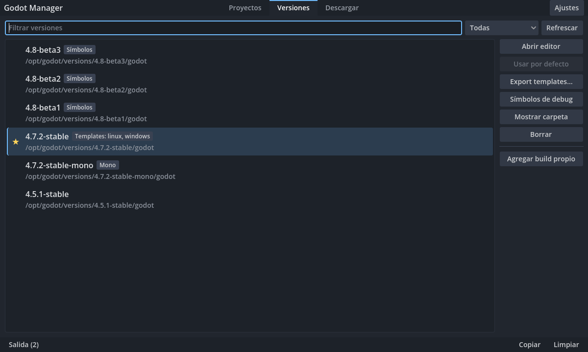

# godot-manager

[English](README.md) · **Español** · [Sitio](https://dann.com.ar/es/godot-manager/)

Un gestor de versiones de [Godot](https://godotengine.org) para Linux y Windows. Instala builds oficiales (stable, dev, .NET/mono), export templates y símbolos de debug, y elige el editor que corresponde a cada proyecto mediante un archivo `.godot-version`.

Tiene dos partes:

- **`godot-manager`**: una herramienta de línea de comandos escrita en Go, con un `godot` que corre la versión que pide el proyecto actual.
- **Una interfaz gráfica opcional** parecida al Project Manager de Godot. Es un proyecto de Godot en [`ui/`](ui/) y hace todo a través de la salida `--json` del CLI.


## Qué hace

- Instala cualquier release de [godotengine/godot-builds](https://github.com/godotengine/godot-builds), incluido el editor .NET (mono), y verifica cada descarga contra el checksum oficial SHA-512 o SHA-256.
- Define una versión default global y una versión por proyecto. La del proyecto está en un archivo `.godot-version`, que `godot` encuentra subiendo desde la carpeta actual.
- Instala export templates solo de las plataformas que pidas. Lee los archivos que hacen falta directo del `.tpz` remoto, así que no baja el archivo entero.
- Instala símbolos de debug del editor y de los templates (desde Godot 4.8-beta1).
- Acepta builds propios con `godot-manager add`.
- Soporta Godot 3.x. En Linux eso incluye el editor, mono y los templates.
- Tiene una salida `--json` para scripts y para la interfaz: un objeto con el resultado, o un evento por línea (progreso, avisos, errores) en las operaciones largas.

## Capturas

| Versiones instaladas | Releases disponibles |
|---|---|
|  |  |


La interfaz está en español y en inglés: usa español si el sistema está en español, e inglés en cualquier otro caso.

## Instalación

### Descarga

Cada [release](https://github.com/dannroda/godot-manager/releases/latest) trae un archivo por plataforma:

| Archivo | Contenido |
|---|---|
| `godot-manager-linux-amd64.tar.gz` | `godot-manager`, `godot` y la interfaz (`godot-manager-ui.x86_64`) |
| `godot-manager-windows-amd64.zip` | `godot-manager.exe`, `godot.exe` y la interfaz (`godot-manager-ui.exe`) |
| `godot-manager-linux-arm64.tar.gz`, `godot-manager-windows-arm64.zip` | solo el CLI |

`SHA256SUMS` tiene el checksum de cada archivo. Descomprimilo donde quieras y abrí `godot-manager-ui`: usa el `godot-manager` que está al lado, así que no hace falta instalar nada más. Para usar `godot-manager` y `godot` desde una terminal, sumá la carpeta al `PATH`.

### Arch Linux

```sh
git clone git@github.com:dannroda/godot-manager.git
cd godot-manager
makepkg -si
```

Instala `/usr/bin/godot-manager` y `/usr/bin/godot`.

### Compilar desde el código

El CLI necesita Go 1.24 o posterior:

```sh
make build  # bin/godot-manager y bin/godot para este sistema
make dist   # dist/<os>-<arch>/ para linux y windows, en amd64 y arm64
```

Los binarios son estáticos y no tienen dependencias. Poné `godot-manager` y `godot` en una carpeta que esté en el `PATH`.

La interfaz necesita Godot 4.8 y sus export templates. Exportala con el preset de Linux o de Windows de `ui/export_presets.cfg`:

```sh
godot --headless --path ui --export-release Linux "$PWD/godot-manager-ui.x86_64"
```

### Dónde guarda las cosas

| | Linux | Windows |
|---|---|---|
| Versiones (`GODOT_DIR`) | `/opt/godot` si existe; si no, `~/.local/share/godot-manager` | `%LOCALAPPDATA%\godot-manager` |
| Export templates | `~/.local/share/godot/export_templates` | `%APPDATA%\Godot\export_templates` |

Definí `GODOT_DIR` para guardar las versiones en otro lado. Los templates van donde los busca el editor de Godot, así que el editor los puede usar enseguida.

## Uso

```sh
godot-manager list-remote stable        # releases disponibles en GitHub
godot-manager install 4.7.2-stable      # descarga, verifica e instala
godot-manager install 4.7.2-stable --mono --templates --platforms=linux,windows
godot-manager set 4.7.2-stable          # default global

cd mi-juego
godot-manager set-local 4.8-beta3       # escribe .godot-version
godot -e                                # abre 4.8-beta3 en este proyecto
godot-manager which                     # qué binario usaría 'godot' acá

godot-manager templates 4.8-beta3 --platforms=web
godot-manager symbols 4.8-beta3         # símbolos de debug del editor
godot-manager add mi-build ~/godot/bin/godot.linuxbsd.editor.x86_64
godot-manager launch --detach 4.5.1-stable
godot-manager remove 4.5.1-stable
```

`godot-manager help` lista todos los comandos y opciones.

### Salida JSON

Con `--json`, `godot-manager` escribe solo JSON en stdout:

- **`list`, `list-remote` y `which`** muestran sus datos.
- **`install`, `templates` y `symbols`** muestran un evento por línea (`step`, `download`, `warn`). La última línea es siempre `done` o `error`.
- **Los demás comandos** muestran `{"ok": true, ...}` o `{"error": {"code": "...", "message": "..."}}`.

Los códigos de error no cambian entre versiones, así que un script puede decidir según ellos: `not_installed`, `no_default`, `rate_limited`, `bad_token`, etc. `--dir <carpeta>` corre un comando como si se hubiera lanzado en esa carpeta.

Sin terminal, cualquier comando que pediría confirmación falla con `needs_confirmation`; pasá `--yes` para confirmar de antemano.

### Token de GitHub

`list-remote` y algunos pasos de la instalación usan la API de GitHub. Sin token, GitHub permite 60 pedidos por hora. Para subir ese límite, definí `GITHUB_TOKEN` con un token personal; no necesita ningún permiso.

## La interfaz

La interfaz es un proyecto de Godot 4.8 en [`ui/`](ui/). Usa el `godot-manager` de su misma carpeta, si no el del `PATH`, o la ruta que le pongas en Ajustes. Viene en los archivos de cada release; para compilarla vos, mirá [Compilar desde el código](#compilar-desde-el-código).

Tiene tres pestañas:

- **Proyectos**: tu lista de proyectos, la versión que usa cada uno y botones para abrirlo, correrlo, cambiarle la versión o instalar la que falta. Puede importar la lista del Project Manager de Godot.
- **Versiones**: las versiones instaladas, con botones para elegir la default, agregar export templates y símbolos de debug, o sumar un build propio.
- **Descargar**: las releases oficiales, con filtros, tamaños y un diálogo de instalación.

## Desarrollo

```sh
go test ./...                    # tests del CLI
godot --headless --path ui -s res://tests/run_tests.gd   # tests de la interfaz
```

Cada push y pull request corre los dos juegos de tests en GitHub Actions (el CLI en Linux y en Windows). Un tag `vX.Y.Z` arma todos los archivos y crea una release en borrador; revisá las notas y publicala desde GitHub.

```sh
git tag v2.2.0 && git push origin v2.2.0
```

Las traducciones de la interfaz están en `ui/i18n/en.po`; los textos fuente están en español. El tablero de tareas de la interfaz está en `ui/compass` (formato Scope Compass).

## Licencia

[MIT](LICENSE).
