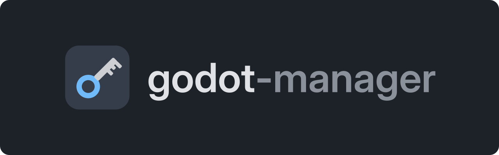
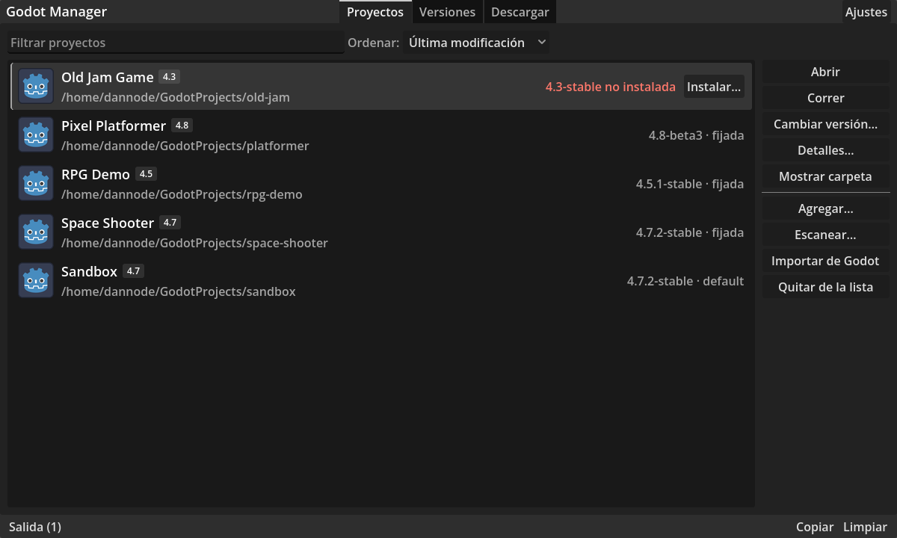
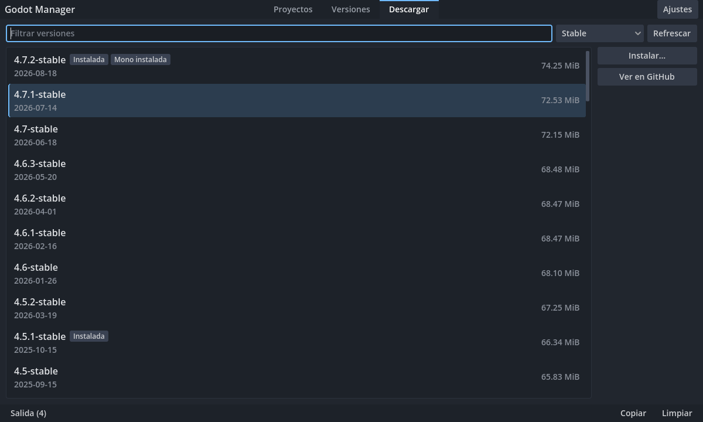
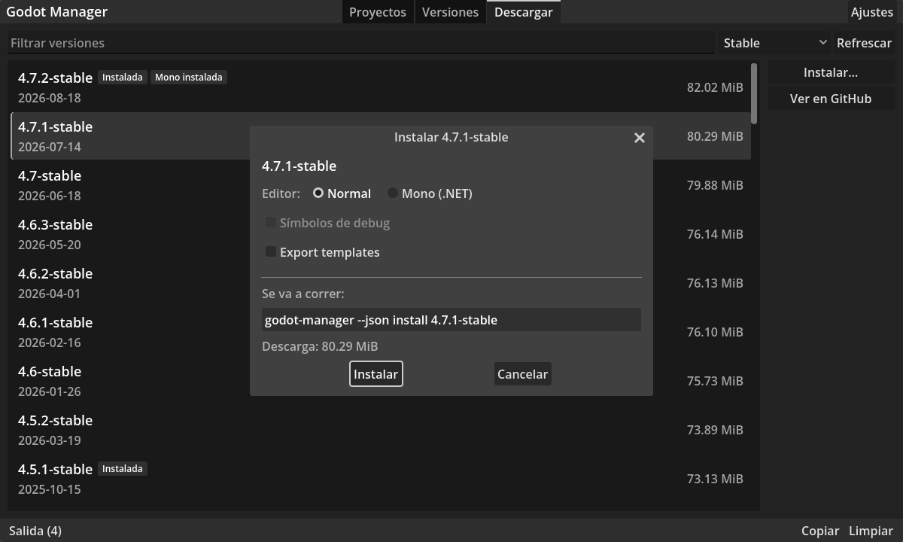
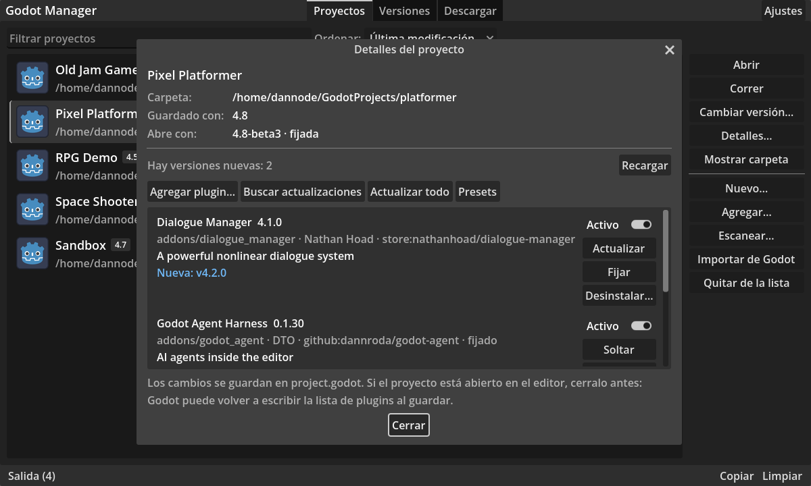

<p align="center"></p>

[English](README.md) · **Español** · [Sitio](https://dann.com.ar/es/godot-manager/)

Un gestor de versiones de [Godot](https://godotengine.org) para Linux, Windows y macOS. Instala builds oficiales (stable, dev, .NET/mono), export templates y símbolos de debug, y elige el editor que corresponde a cada proyecto mediante un archivo `.godot-version`.

Tiene dos partes:

- **`godot-manager`**: una herramienta de línea de comandos escrita en Go, con un `godot` que corre la versión que pide el proyecto actual.
- **Una interfaz gráfica opcional** parecida al Project Manager de Godot. Es un proyecto de Godot en [`ui/`](ui/) y hace todo a través de la salida `--json` del CLI. Anda en Linux y Windows.



## Qué hace

- Instala cualquier release de [godotengine/godot-builds](https://github.com/godotengine/godot-builds), incluido el editor .NET (mono), y verifica cada descarga contra el checksum oficial SHA-512 o SHA-256.
- Define una versión default global y una versión por proyecto. La del proyecto está en un archivo `.godot-version`, que `godot` encuentra subiendo desde la carpeta actual.
- Instala export templates solo de las plataformas que pidas. Lee los archivos que hacen falta directo del `.tpz` remoto, así que no baja el archivo entero.
- Instala símbolos de debug del editor y de los templates (desde Godot 4.8-beta1).
- Avisa cuando una versión instalada tiene una release más nueva de su serie (4.7.1 → 4.7.2, 4.8-beta3 → 4.8-rc1) y la actualiza con lo mismo que tenía.
- Libera espacio: `prune` borra las versiones que no usa la default ni ninguno de tus proyectos.
- Maneja los plugins de cada proyecto desde el [Asset Store de Godot](https://store.godotengine.org) y GitHub: elige versiones que andan con el Godot del proyecto, las anota en `plugins.json` y `plugins.lock`, y las actualiza o las fija. Los presets suman de una vez los plugins que usás siempre.
- Crea proyectos nuevos con `godot-manager new`, con una versión de Godot fijada y un preset de plugins.
- Acepta builds propios con `godot-manager add`.
- Soporta Godot 3.x. En Linux eso incluye el editor, mono y los templates.
- Tiene una salida `--json` para scripts y para la interfaz: un objeto con el resultado, o un evento por línea (progreso, avisos, errores) en las operaciones largas.

## Capturas

| Versiones instaladas | Releases disponibles |
|---|---|
|  |  |

| Diálogo de instalación | Plugins del proyecto |
|---|---|
|  |  |

La interfaz está en español y en inglés: usa español si el sistema está en español, e inglés en cualquier otro caso.

## Instalación

### Descarga

Cada [release](https://github.com/dannroda/godot-manager/releases/latest) trae un archivo por plataforma:

| Archivo | Contenido |
|---|---|
| `godot-manager-linux-amd64.tar.gz` | `godot-manager`, `godot` y la interfaz (`godot-manager-ui.x86_64`) |
| `godot-manager-windows-amd64.zip` | `godot-manager.exe`, `godot.exe` y la interfaz (`godot-manager-ui.exe`) |
| `godot-manager-linux-arm64.tar.gz`, `godot-manager-windows-arm64.zip` | solo el CLI |
| `godot-manager-darwin-arm64.tar.gz`, `godot-manager-darwin-amd64.tar.gz` | solo el CLI (macOS) |

`SHA256SUMS` tiene el checksum de cada archivo. Descomprimilo donde quieras y abrí `godot-manager-ui`: usa el `godot-manager` que está al lado, así que no hace falta instalar nada más. Para usar `godot-manager` y `godot` desde una terminal, corré `godot-manager path add` (o usá el botón en los Ajustes de la interfaz): en Windows suma la carpeta al `PATH` del usuario; en Linux y macOS crea symlinks en `~/.local/bin`.

Para actualizar, corré `godot-manager self-update`, o tocá Actualizar cuando la interfaz avise que hay una versión nueva. Reemplaza los archivos en esa misma carpeta. Si lo instalaste con un gestor de paquetes (pacman, Scoop), actualizalo por ahí.

### Windows: Scoop

```powershell
scoop bucket add godot-manager https://github.com/dannroda/godot-manager
scoop install godot-manager
```

Deja `godot-manager` y `godot` en el `PATH` y agrega la interfaz al menú Inicio.

### Arch Linux

[`packaging/arch/PKGBUILD`](packaging/arch/PKGBUILD) arma un paquete `godot-manager-bin` con los binarios de la release, la interfaz con su entrada en el menú y el autocompletado:

```sh
git clone https://github.com/dannroda/godot-manager.git
cd godot-manager/packaging/arch
makepkg -si
```

Para compilar el CLI desde este repo (sin la interfaz):

```sh
git clone https://github.com/dannroda/godot-manager.git
cd godot-manager
makepkg -si
```

### Compilar desde el código

El CLI necesita Go 1.24 o posterior:

```sh
make build  # bin/godot-manager y bin/godot para este sistema
make dist   # dist/<os>-<arch>/ para linux, windows y macOS, en amd64 y arm64
```

Los binarios son estáticos y no tienen dependencias. Poné `godot-manager` y `godot` en una carpeta que esté en el `PATH`.

La interfaz necesita Godot 4.8 y sus export templates. Exportala con el preset de Linux o de Windows de `ui/export_presets.cfg`:

```sh
godot --headless --path ui --export-release Linux "$PWD/godot-manager-ui.x86_64"
```

### Dónde guarda las cosas

| | Linux | Windows | macOS |
|---|---|---|---|
| Versiones (`GODOT_DIR`) | `/opt/godot` si existe; si no, `~/.local/share/godot-manager` | `%LOCALAPPDATA%\godot-manager` | `~/Library/Application Support/godot-manager` |
| Export templates | `~/.local/share/godot/export_templates` | `%APPDATA%\Godot\export_templates` | `~/Library/Application Support/Godot/export_templates` |

Definí `GODOT_DIR` para guardar las versiones en otro lado. Los templates van donde los busca el editor de Godot, así que el editor los puede usar enseguida.

## Uso

```sh
godot-manager list-remote stable        # releases disponibles en GitHub
godot-manager install 4.7.2-stable      # descarga, verifica e instala
godot-manager install 4.7.2-stable --mono --templates --platforms=linux,windows
godot-manager set 4.7.2-stable          # default global

cd mi-juego
godot-manager set-local 4.8-beta3       # escribe .godot-version
godot -e                                # abre 4.8-beta3 en este proyecto
godot-manager which                     # qué binario usaría 'godot' acá

godot-manager templates 4.8-beta3 --platforms=web
godot-manager symbols 4.8-beta3         # símbolos de debug del editor
godot-manager add mi-build ~/godot/bin/godot.linuxbsd.editor.x86_64
godot-manager launch --detach 4.5.1-stable
godot-manager remove 4.5.1-stable

godot-manager plugins                   # plugins del proyecto actual
godot-manager plugins disable roto      # desactiva uno sin abrir el editor
godot-manager plugins search dialogue   # busca en el Asset Store de Godot
godot-manager plugins add nathanhoad/dialogue-manager
godot-manager plugins add github:dannroda/godot-agent@v0.1.32   # fijado en esa versión
godot-manager plugins outdated          # versiones nuevas que andan con el Godot del proyecto
godot-manager plugins update            # actualiza todo lo que no está fijado
godot-manager plugins install           # lo que pide plugins.json, en las versiones de plugins.lock
godot-manager presets save mis-plugins  # los plugins.json de este proyecto como preset
godot-manager plugins apply mis-plugins # suma los plugins de un preset a otro proyecto
godot-manager new ~/juegos/otro --version 4.5.1-stable --preset mis-plugins

godot-manager outdated                  # versiones instaladas con una más nueva de su serie
godot-manager upgrade 4.7.1-stable      # instala 4.7.2-stable con lo mismo que tenía
godot-manager prune --dry-run           # qué borraría prune y cuánto espacio libera

godot-manager path add                  # pone godot-manager y godot en el PATH
godot-manager dirs                      # carpetas que usa (GODOT_DIR y la por defecto)
godot-manager self-update               # actualiza el propio godot-manager
```

### Plugins

`plugins add` instala un plugin del [Asset Store de Godot](https://store.godotengine.org) (`store:publisher/slug`, o `publisher/slug` solo) o de los releases de un repo de GitHub (`github:owner/repo`), y lo activa. Elige la versión más nueva que anda con el Godot del proyecto (su `.godot-version`, o `config/features` de `project.godot`), así que un proyecto que se queda en un Godot viejo sigue recibiendo versiones de plugins que andan con él. `plugins outdated` además dice qué versiones nuevas piden un Godot más nuevo.

Lo anotan dos archivos JSON en la raíz del proyecto, para subirlos al repo y que cualquiera corra `plugins install`:

- `plugins.json`: lo que pide el proyecto. Un plugin con `version` queda fijado (`plugins pin`/`unpin`, o `add fuente@versión`).
- `plugins.lock`: lo que quedó instalado: la versión exacta, el sha256 del zip y un hash de cada archivo. `install` verifica el zip, y `update` no pisa archivos que cambiaste a mano salvo con `--force`.

Los **presets** son los plugins que solés usar, guardados en `$GODOT_DIR/presets/<nombre>.json` (con el formato de `plugins.json`). Se crean con `presets save <nombre>` en un proyecto (`--pin` congela cada plugin en la versión que tiene instalada ahí, para proyectos que se quedan en el mismo Godot) o con `presets add <nombre> <fuente>[@versión]...`. `plugins apply <preset>` suma los plugins de un preset a un proyecto, y `new <carpeta> --preset <nombre>` crea un proyecto de Godot 4 vacío (con `.godot-version` si le pasás `--version`) que ya los tiene.

El trabajo lo hace [`pluginkit/`](pluginkit/README.md), una librería en GDScript que godot-manager corre con un Godot 4.2+ instalado (sin ventana) y que también pueden usar addons del editor.

`prune` deja la versión default y todas las que fija algún proyecto que conoce: las carpetas que le pases, los proyectos del Project Manager de Godot y la carpeta actual. Nunca toca los builds agregados con `add`.

### Autocompletado

`godot-manager completion <shell>` escribe un script de autocompletado que también completa los nombres de las versiones instaladas:

```sh
# bash (~/.bashrc)
source <(godot-manager completion bash)
# zsh (~/.zshrc)
source <(godot-manager completion zsh)
# fish
godot-manager completion fish > ~/.config/fish/completions/godot-manager.fish
```

```powershell
# PowerShell ($PROFILE)
godot-manager completion powershell | Out-String | Invoke-Expression
```

El paquete de Arch lo instala para bash, zsh y fish.

`godot-manager help` lista todos los comandos y opciones.

### Salida JSON

Con `--json`, `godot-manager` escribe solo JSON en stdout:

- **`list`, `list-remote`, `which`, `outdated`, `path`, `dirs`, `presets` y `plugins` (`list`, `search`, `outdated`)** muestran sus datos.
- **`install`, `templates`, `symbols`, `upgrade`, `new` y `plugins` (`add`, `install`, `update`, `pin`, `apply`)** muestran un evento por línea (`step`, `download`, `warn`). La última línea es siempre `done` o `error`.
- **Los demás comandos** muestran `{"ok": true, ...}` o `{"error": {"code": "...", "message": "..."}}`.

Los códigos de error no cambian entre versiones, así que un script puede decidir según ellos: `not_installed`, `no_default`, `rate_limited`, `bad_token`, etc. `--dir <carpeta>` corre un comando como si se hubiera lanzado en esa carpeta.

Sin terminal, cualquier comando que pediría confirmación falla con `needs_confirmation`; pasá `--yes` para confirmar de antemano.

### Token de GitHub

`list-remote`, algunos pasos de la instalación y los plugins de GitHub usan la API de GitHub. Sin token, GitHub permite 60 pedidos por hora. Para subir ese límite, definí `GITHUB_TOKEN` con un token personal; no necesita ningún permiso.

## La interfaz

La interfaz es un proyecto de Godot 4.8 en [`ui/`](ui/). Usa el `godot-manager` de su misma carpeta, si no el del `PATH`, o la ruta que le pongas en Ajustes. Viene en los archivos de cada release; para compilarla vos, mirá [Compilar desde el código](#compilar-desde-el-código).

Tiene tres pestañas:

- **Proyectos**: tu lista de proyectos, la versión que usa cada uno y botones para abrirlo, correrlo, cambiarle la versión o instalar la que falta. **Nuevo…** crea un proyecto vacío con una versión de Godot y un preset de plugins, igual que el Project Manager de Godot: la carpeta con el mismo nombre (en kebab-case, o con la convención que tengas en los ajustes del editor de Godot) y el ícono de Godot. En sus detalles están los plugins del proyecto, para desactivar uno que no deja abrir el editor; ahí también se agregan plugins del Asset Store o de GitHub (los nuestros, godot-agent y scope-compass, a un clic), se buscan y aplican actualizaciones que andan con el Godot del proyecto, se fija o suelta una versión y se aplican o guardan presets. Puede importar la lista del Project Manager de Godot.
- **Versiones**: las versiones instaladas, con botones para elegir la default, agregar export templates y símbolos de debug, o sumar un build propio. Marca las que tienen una release más nueva de su serie y las actualiza, y **Liberar espacio** borra las que no usa ningún proyecto.
- **Descargar**: las releases oficiales, con filtros, tamaños y un diálogo de instalación.

## Desarrollo

```sh
go test ./...                    # tests del CLI
godot --headless --path ui -s res://tests/run_tests.gd   # tests de la interfaz
godot --headless --path pluginkit -s res://tests/run_tests.gd   # tests de la librería de plugins
```

Cada push y pull request corre los tres juegos de tests en GitHub Actions (el CLI en Linux, Windows y macOS, y además una instalación real de Godot en macOS). Cada cambio va a la sección **Unreleased** de [`CHANGELOG.md`](CHANGELOG.md), en inglés, a medida que entra. Para sacar una release, corré **Actions → Release → Run workflow** sobre `main` con `patch`, `minor`, `major` o una versión exacta. El workflow corre los tests, arma todos los archivos, pasa la sección Unreleased a la versión nueva, la commitea con el tag `vX.Y.Z` y publica la release con esa sección como notas. Si es estable, después se actualizan el PKGBUILD de Arch y el manifest de Scoop (`tools/packaging.go`).

```sh
gh workflow run release.yml -f bump=patch
```

Los íconos de los `.exe` salen de `cmd/*/rsrc_windows_*.syso`; si cambia `ui/icon.ico`, se regeneran con `go run tools/winres.go`.

Las traducciones de la interfaz están en `ui/i18n/en.po`; los textos fuente están en español.

## Licencia

[MIT](LICENSE).
