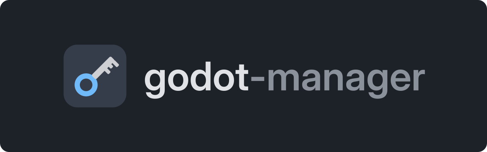
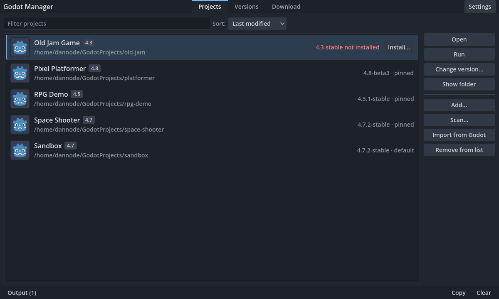
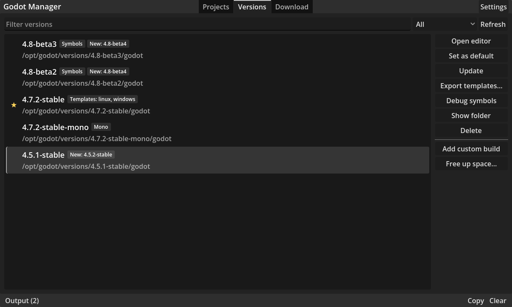
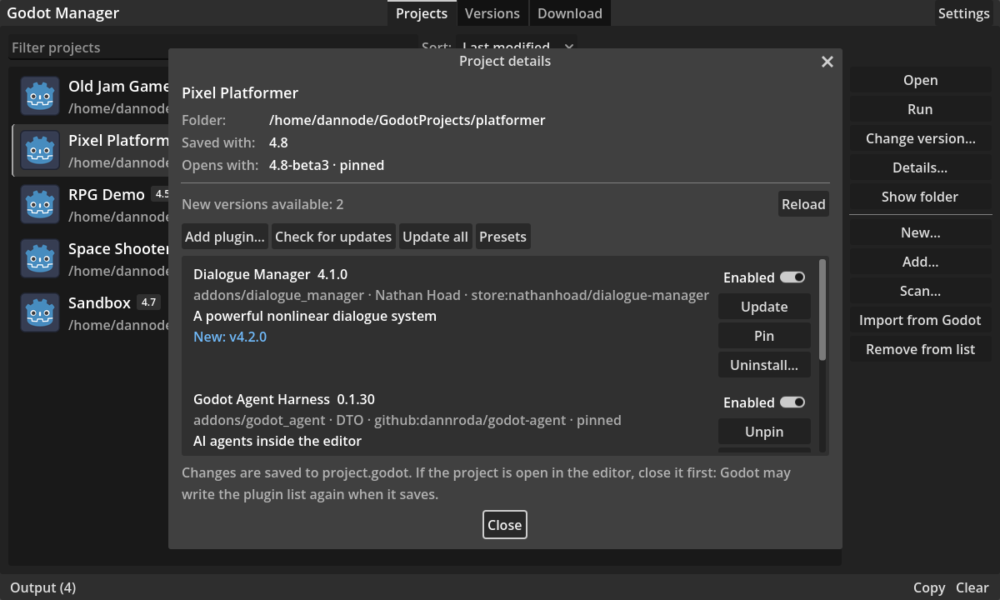

<p align="center"></p>

**English** · [Español](README.es.md) · [Website](https://dann.com.ar/en/godot-manager/)

A version manager for [Godot](https://godotengine.org) on Linux, Windows and macOS. It installs official builds (stable, dev, .NET/mono), export templates and debug symbols, and picks the right editor for each project through a `.godot-version` file.

It has two parts:

- **`godot-manager`**: a command-line tool written in Go, with a `godot` shim that runs the version the current project asks for.
- **An optional GUI** that looks like Godot's Project Manager. It is a Godot project in [`ui/`](ui/) and does all its work through the CLI's `--json` output. It runs on Linux and Windows.



## Features

- Installs any release from [godotengine/godot-builds](https://github.com/godotengine/godot-builds), including the .NET (mono) editor, and verifies every download against the official SHA-512 or SHA-256 checksum.
- Sets a global default version and a per-project version. The project version lives in a `.godot-version` file, which `godot` finds by walking up from the current folder.
- Installs export templates only for the platforms you ask for. It reads the files it needs straight out of the remote `.tpz`, so you don't download the whole archive.
- Installs debug symbols for the editor and the templates (Godot 4.8-beta1 and later).
- Tells you when an installed version has a newer release in its series (4.7.1 → 4.7.2, 4.8-beta3 → 4.8-rc1) and upgrades it with the same extras.
- Frees disk space: `prune` deletes the versions that neither the default nor any of your projects use.
- Manages each project's plugins from the [Godot Asset Store](https://store.godotengine.org) and GitHub: it picks versions that work with the project's Godot, records them in `plugins.json` and `plugins.lock`, and updates or pins them. Presets add the plugins you always use to a project in one go.
- Creates new projects with `godot-manager new`, with a pinned Godot version and a plugin preset.
- Supports your own builds with `godot-manager add`.
- Supports Godot 3.x. On Linux this covers the editor, mono and templates.
- Has a `--json` output for scripts and the GUI: one result object, or one event per line (progress, warnings, errors) for long operations.

## Screenshots

| Installed versions | Available releases |
|---|---|
|  |  |

| Install dialog | Project plugins |
|---|---|
|  |  |

The GUI is in English and Spanish. It uses Spanish when the system language is Spanish, and English otherwise.

## Installation

### Download

Each [release](https://github.com/dannroda/godot-manager/releases/latest) has an archive per platform:

| Archive | Contents |
|---|---|
| `godot-manager-linux-amd64.tar.gz` | `godot-manager`, `godot` and the GUI (`godot-manager-ui.x86_64`) |
| `godot-manager-windows-amd64.zip` | `godot-manager.exe`, `godot.exe` and the GUI (`godot-manager-ui.exe`) |
| `godot-manager-linux-arm64.tar.gz`, `godot-manager-windows-arm64.zip` | the CLI only |
| `godot-manager-darwin-arm64.tar.gz`, `godot-manager-darwin-amd64.tar.gz` | the CLI only (macOS) |

`SHA256SUMS` has the checksum of each archive. Extract it anywhere and open `godot-manager-ui`: it uses the `godot-manager` next to it, so nothing else needs installing. To use `godot-manager` and `godot` from a terminal, run `godot-manager path add` (or use the button in the GUI's Settings): on Windows it adds the folder to your user `PATH`; on Linux and macOS it creates symlinks in `~/.local/bin`.

To update, run `godot-manager self-update`, or click Update when the GUI says a new version is out. It replaces the files in that same folder. If you installed it with a package manager (pacman, Scoop), update it there instead.

### Windows: Scoop

```powershell
scoop bucket add godot-manager https://github.com/dannroda/godot-manager
scoop install godot-manager
```

It puts `godot-manager` and `godot` on the `PATH` and adds the GUI to the Start menu.

### Arch Linux

[`packaging/arch/PKGBUILD`](packaging/arch/PKGBUILD) builds a `godot-manager-bin` package from the release binaries, with the GUI, its menu entry and shell completion:

```sh
git clone https://github.com/dannroda/godot-manager.git
cd godot-manager/packaging/arch
makepkg -si
```

To build the CLI from this repository instead (without the GUI):

```sh
git clone https://github.com/dannroda/godot-manager.git
cd godot-manager
makepkg -si
```

### Build from source

The CLI needs Go 1.24 or later:

```sh
make build  # bin/godot-manager and bin/godot for this system
make dist   # dist/<os>-<arch>/ for linux, windows and macOS, amd64 and arm64
```

The binaries are static and have no dependencies. Put `godot-manager` and `godot` in a folder that is on your `PATH`.

The GUI needs Godot 4.8 and its export templates. Export it with the Linux or Windows preset in `ui/export_presets.cfg`:

```sh
godot --headless --path ui --export-release Linux "$PWD/godot-manager-ui.x86_64"
```

### Where things go

| | Linux | Windows | macOS |
|---|---|---|---|
| Versions (`GODOT_DIR`) | `/opt/godot` if it exists, otherwise `~/.local/share/godot-manager` | `%LOCALAPPDATA%\godot-manager` | `~/Library/Application Support/godot-manager` |
| Export templates | `~/.local/share/godot/export_templates` | `%APPDATA%\Godot\export_templates` | `~/Library/Application Support/Godot/export_templates` |

Set `GODOT_DIR` to keep your versions somewhere else. Templates go where the Godot editor looks for them, so the editor can use them right away.

## Usage

```sh
godot-manager list-remote stable        # releases available on GitHub
godot-manager install 4.7.2-stable      # download, verify and install
godot-manager install 4.7.2-stable --mono --templates --platforms=linux,windows
godot-manager set 4.7.2-stable          # global default

cd my-game
godot-manager set-local 4.8-beta3       # writes .godot-version
godot -e                                # opens 4.8-beta3 in this project
godot-manager which                     # which binary 'godot' would use here

godot-manager templates 4.8-beta3 --platforms=web
godot-manager symbols 4.8-beta3         # debug symbols for the editor
godot-manager add my-build ~/godot/bin/godot.linuxbsd.editor.x86_64
godot-manager launch --detach 4.5.1-stable
godot-manager remove 4.5.1-stable

godot-manager plugins                   # plugins of the current project
godot-manager plugins disable broken    # disable one without opening the editor
godot-manager plugins search dialogue   # search the Godot Asset Store (no text: the top-rated ones)
godot-manager plugins add nathanhoad/dialogue-manager
godot-manager plugins add github:dannroda/godot-agent@v0.1.32   # pinned to that version
godot-manager plugins outdated          # newer versions that work with the project's Godot
godot-manager plugins update            # update everything that isn't pinned
godot-manager plugins install           # what plugins.json asks for, at the plugins.lock versions
godot-manager presets save my-plugins   # this project's plugins.json as a preset
godot-manager plugins apply my-plugins  # add a preset's plugins to another project
godot-manager new ~/games/next --version 4.5.1-stable --preset my-plugins

godot-manager outdated                  # installed versions with a newer release in their series
godot-manager upgrade 4.7.1-stable      # install 4.7.2-stable with the same extras
godot-manager prune --dry-run           # what prune would delete, and how much space it frees

godot-manager path add                  # put godot-manager and godot on the PATH
godot-manager dirs                      # folders it uses (GODOT_DIR and its default)
godot-manager self-update               # update godot-manager itself
```

### Plugins

`plugins add` installs a plugin from the [Godot Asset Store](https://store.godotengine.org) (`store:publisher/slug`, or just `publisher/slug`) or from a GitHub repo's releases (`github:owner/repo`), and enables it. It picks the newest version that works with the project's Godot (its `.godot-version`, or `config/features` in `project.godot`), so a project that stays on an older Godot keeps getting plugin versions that work with it. `plugins outdated` also tells you which newer versions need a newer Godot.

Two JSON files in the project root keep track of it, so you can commit them and anyone can run `plugins install`:

- `plugins.json`: what the project asks for. A plugin with a `version` is pinned (`plugins pin`/`unpin`, or `add source@version`).
- `plugins.lock`: what got installed: exact version, the zip's sha256 and a hash of every file. `install` verifies the zip, and `update` won't overwrite files you changed by hand unless you pass `--force`.

**Presets** are the plugins you usually use, saved in `$GODOT_DIR/presets/<name>.json` (the same format as `plugins.json`). Create one with `presets save <name>` in a project (`--pin` freezes each plugin at the version installed there, for projects that stay on the same Godot) or with `presets add <name> <source>[@version]...`. `plugins apply <preset>` adds a preset's plugins to a project, and `new <folder> --preset <name>` creates an empty Godot 4 project (with `.godot-version` if you pass `--version`) that already has them.

The work is done by [`pluginkit/`](pluginkit/README.md), a GDScript library that godot-manager runs with an installed Godot 4.2+ (no window), and that editor addons can use too.

`prune` keeps the default version and every version pinned by a project it knows about: the folders you pass it, the projects in Godot's Project Manager, and the current folder. It never touches builds added with `add`.

### Shell completion

`godot-manager completion <shell>` prints a completion script that also completes installed version names:

```sh
# bash (~/.bashrc)
source <(godot-manager completion bash)
# zsh (~/.zshrc)
source <(godot-manager completion zsh)
# fish
godot-manager completion fish > ~/.config/fish/completions/godot-manager.fish
```

```powershell
# PowerShell ($PROFILE)
godot-manager completion powershell | Out-String | Invoke-Expression
```

The Arch package installs it for bash, zsh and fish.

`godot-manager help` lists every command and option.

### JSON output

With `--json`, `godot-manager` writes only JSON to stdout:

- **`list`, `list-remote`, `which`, `outdated`, `path`, `dirs`, `presets` and `plugins` (`list`, `search`, `outdated`)** print their data.
- **`install`, `templates`, `symbols`, `upgrade`, `new` and `plugins` (`add`, `install`, `update`, `pin`, `apply`)** print one event per line (`step`, `download`, `warn`). The last line is always `done` or `error`.
- **Every other command** prints `{"ok": true, ...}` or `{"error": {"code": "...", "message": "..."}}`.

Error codes don't change between versions, so a script can branch on them: `not_installed`, `no_default`, `rate_limited`, `bad_token` and so on. `--dir <folder>` runs a command as if it were started in that folder.

Without a terminal, any command that would ask for confirmation fails with `needs_confirmation`; pass `--yes` to confirm in advance.

### GitHub token

`list-remote`, some install steps and plugins from GitHub call the GitHub API. Without a token, GitHub allows 60 requests per hour. To raise that limit, set `GITHUB_TOKEN` to a personal access token; it needs no scopes.

## The GUI

The GUI is a Godot 4.8 project in [`ui/`](ui/). It uses the `godot-manager` in its own folder, then the one on the `PATH`, or the path you set in its Settings. It comes in the release archives; to build it yourself, see [Build from source](#build-from-source).

It has three tabs:

- **Projects**: your project list, the version each one resolves to, and buttons to open, run, change the version or install a missing one. **New…** creates an empty project with a Godot version and a plugin preset, as Godot's Project Manager does: the same folder name (kebab-case, or the naming convention set in Godot's editor settings) and the Godot icon. Its details show the project's plugins, so you can disable one that keeps the editor from opening; there you can also add plugins from the Asset Store or GitHub (ours, godot-agent and scope-compass, are one click away), check for and apply updates that work with the project's Godot, pin or unpin a version, and apply or save presets. It can import the list from Godot's Project Manager.
- **Versions**: installed versions, with buttons to set the default, add export templates and debug symbols, or add your own build. It marks the versions with a newer release in their series and upgrades them, and **Free up space** deletes the ones no project uses.
- **Download**: official releases with filters, sizes and an install dialog.

## Development

```sh
go test ./...                    # CLI tests
godot --headless --path ui -s res://tests/run_tests.gd   # GUI tests
godot --headless --path pluginkit -s res://tests/run_tests.gd   # plugin library tests
```

Pushes and pull requests run the three test suites on GitHub Actions (the CLI on Linux, Windows and macOS, plus a real Godot install on macOS). Write each change in the **Unreleased** section of [`CHANGELOG.md`](CHANGELOG.md) as it lands. To release, run **Actions → Release → Run workflow** on `main` with `patch`, `minor`, `major` or an exact version. The workflow runs the tests, builds every archive, moves the Unreleased section under the new version, commits it with the `vX.Y.Z` tag and publishes the release with that section as its notes. A stable release then updates the Arch PKGBUILD and the Scoop manifest (`tools/packaging.go`).

```sh
gh workflow run release.yml -f bump=patch
```

The `.exe` icons come from `cmd/*/rsrc_windows_*.syso`; after changing `ui/icon.ico`, regenerate them with `go run tools/winres.go`.

The GUI's translations are in `ui/i18n/en.po`; the source strings are in Spanish.

## License

[MIT](LICENSE).
