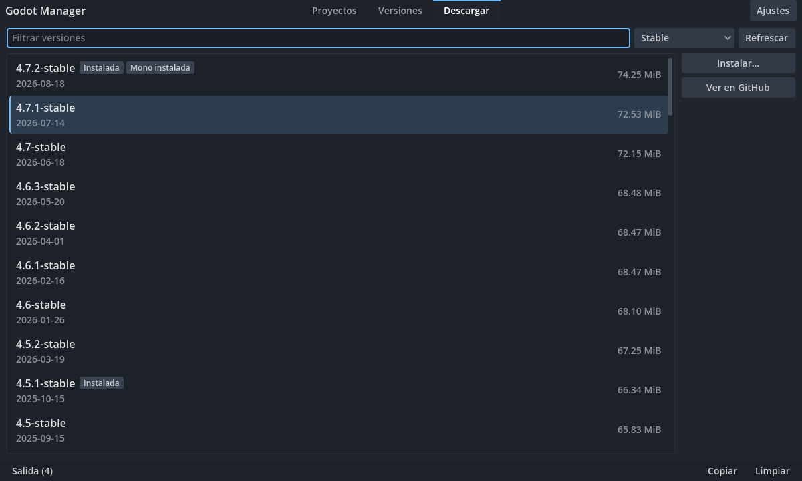
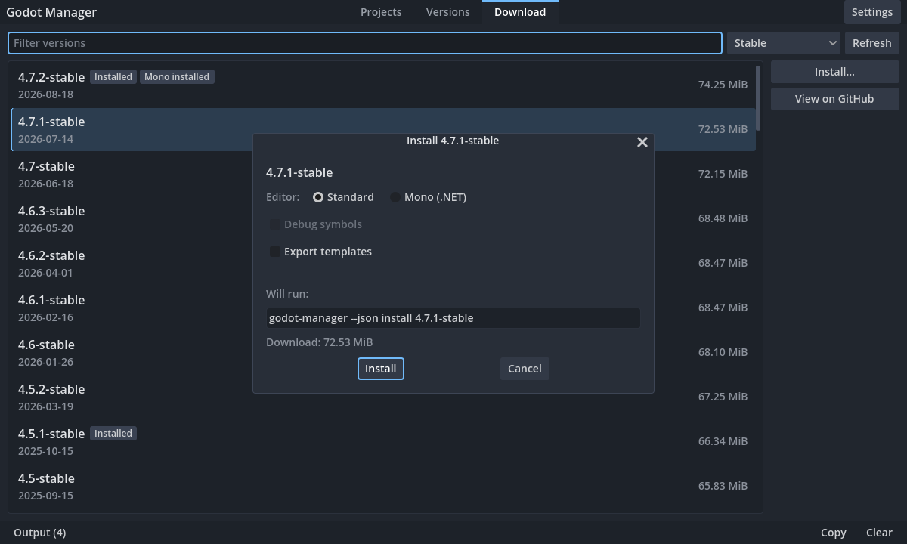

<p align="center"></p>

**English** · [Español](README.es.md) · [Website](https://dann.com.ar/en/godot-manager/)

A version manager for [Godot](https://godotengine.org) on Linux and Windows. It installs official builds (stable, dev, .NET/mono), export templates and debug symbols, and picks the right editor for each project through a `.godot-version` file.

It has two parts:

- **`godot-manager`**: a command-line tool written in Go, with a `godot` shim that runs the version the current project asks for.
- **An optional GUI** that looks like Godot's Project Manager. It is a Godot project in [`ui/`](ui/) and does all its work through the CLI's `--json` output.


## Features

- Installs any release from [godotengine/godot-builds](https://github.com/godotengine/godot-builds), including the .NET (mono) editor, and verifies every download against the official SHA-512 or SHA-256 checksum.
- Sets a global default version and a per-project version. The project version lives in a `.godot-version` file, which `godot` finds by walking up from the current folder.
- Installs export templates only for the platforms you ask for. It reads the files it needs straight out of the remote `.tpz`, so you don't download the whole archive.
- Installs debug symbols for the editor and the templates (Godot 4.8-beta1 and later).
- Supports your own builds with `godot-manager add`.
- Supports Godot 3.x. On Linux this covers the editor, mono and templates.
- Has a `--json` output for scripts and the GUI: one result object, or one event per line (progress, warnings, errors) for long operations.

## Screenshots

| Installed versions | Available releases |
|---|---|
|  |  |



The GUI is in English and Spanish. It uses Spanish when the system language is Spanish, and English otherwise.

## Installation

### Download

Each [release](https://github.com/dannroda/godot-manager/releases/latest) has an archive per platform:

| Archive | Contents |
|---|---|
| `godot-manager-linux-amd64.tar.gz` | `godot-manager`, `godot` and the GUI (`godot-manager-ui.x86_64`) |
| `godot-manager-windows-amd64.zip` | `godot-manager.exe`, `godot.exe` and the GUI (`godot-manager-ui.exe`) |
| `godot-manager-linux-arm64.tar.gz`, `godot-manager-windows-arm64.zip` | the CLI only |

`SHA256SUMS` has the checksum of each archive. Extract it anywhere and open `godot-manager-ui`: it uses the `godot-manager` next to it, so nothing else needs installing. To use `godot-manager` and `godot` from a terminal, add the folder to your `PATH`.

To update, run `godot-manager self-update`, or click Update when the GUI says a new version is out. It replaces the files in that same folder. If you installed it with a package manager (the Arch package), update it there instead.

### Arch Linux

```sh
git clone git@github.com:dannroda/godot-manager.git
cd godot-manager
makepkg -si
```

This installs `/usr/bin/godot-manager` and `/usr/bin/godot`.

### Build from source

The CLI needs Go 1.24 or later:

```sh
make build  # bin/godot-manager and bin/godot for this system
make dist   # dist/<os>-<arch>/ for linux and windows, amd64 and arm64
```

The binaries are static and have no dependencies. Put `godot-manager` and `godot` in a folder that is on your `PATH`.

The GUI needs Godot 4.8 and its export templates. Export it with the Linux or Windows preset in `ui/export_presets.cfg`:

```sh
godot --headless --path ui --export-release Linux "$PWD/godot-manager-ui.x86_64"
```

### Where things go

| | Linux | Windows |
|---|---|---|
| Versions (`GODOT_DIR`) | `/opt/godot` if it exists, otherwise `~/.local/share/godot-manager` | `%LOCALAPPDATA%\godot-manager` |
| Export templates | `~/.local/share/godot/export_templates` | `%APPDATA%\Godot\export_templates` |

Set `GODOT_DIR` to keep your versions somewhere else. Templates go where the Godot editor looks for them, so the editor can use them right away.

## Usage

```sh
godot-manager list-remote stable        # releases available on GitHub
godot-manager install 4.7.2-stable      # download, verify and install
godot-manager install 4.7.2-stable --mono --templates --platforms=linux,windows
godot-manager set 4.7.2-stable          # global default

cd my-game
godot-manager set-local 4.8-beta3       # writes .godot-version
godot -e                                # opens 4.8-beta3 in this project
godot-manager which                     # which binary 'godot' would use here

godot-manager templates 4.8-beta3 --platforms=web
godot-manager symbols 4.8-beta3         # debug symbols for the editor
godot-manager add my-build ~/godot/bin/godot.linuxbsd.editor.x86_64
godot-manager launch --detach 4.5.1-stable
godot-manager remove 4.5.1-stable

godot-manager plugins                   # plugins of the current project
godot-manager plugins disable broken    # disable one without opening the editor

godot-manager self-update               # update godot-manager itself
```

`godot-manager help` lists every command and option.

### JSON output

With `--json`, `godot-manager` writes only JSON to stdout:

- **`list`, `list-remote` and `which`** print their data.
- **`install`, `templates` and `symbols`** print one event per line (`step`, `download`, `warn`). The last line is always `done` or `error`.
- **Every other command** prints `{"ok": true, ...}` or `{"error": {"code": "...", "message": "..."}}`.

Error codes don't change between versions, so a script can branch on them: `not_installed`, `no_default`, `rate_limited`, `bad_token` and so on. `--dir <folder>` runs a command as if it were started in that folder.

Without a terminal, any command that would ask for confirmation fails with `needs_confirmation`; pass `--yes` to confirm in advance.

### GitHub token

`list-remote` and some install steps call the GitHub API. Without a token, GitHub allows 60 requests per hour. To raise that limit, set `GITHUB_TOKEN` to a personal access token; it needs no scopes.

## The GUI

The GUI is a Godot 4.8 project in [`ui/`](ui/). It uses the `godot-manager` in its own folder, then the one on the `PATH`, or the path you set in its Settings. It comes in the release archives; to build it yourself, see [Build from source](#build-from-source).

It has three tabs:

- **Projects**: your project list, the version each one resolves to, and buttons to open, run, change the version or install a missing one. Its details show the project's plugins, so you can disable one that keeps the editor from opening. It can import the list from Godot's Project Manager.
- **Versions**: installed versions, with buttons to set the default, add export templates and debug symbols, or add your own build.
- **Download**: official releases with filters, sizes and an install dialog.

## Development

```sh
go test ./...                    # CLI tests
godot --headless --path ui -s res://tests/run_tests.gd   # GUI tests
```

Pushes and pull requests run both test suites on GitHub Actions (the CLI on Linux and Windows). Pushing a `vX.Y.Z` tag builds every archive and creates a draft release; review the notes and publish it from GitHub.

```sh
git tag v2.2.0 && git push origin v2.2.0
```

The GUI's translations are in `ui/i18n/en.po`; the source strings are in Spanish.

## License

[MIT](LICENSE).
